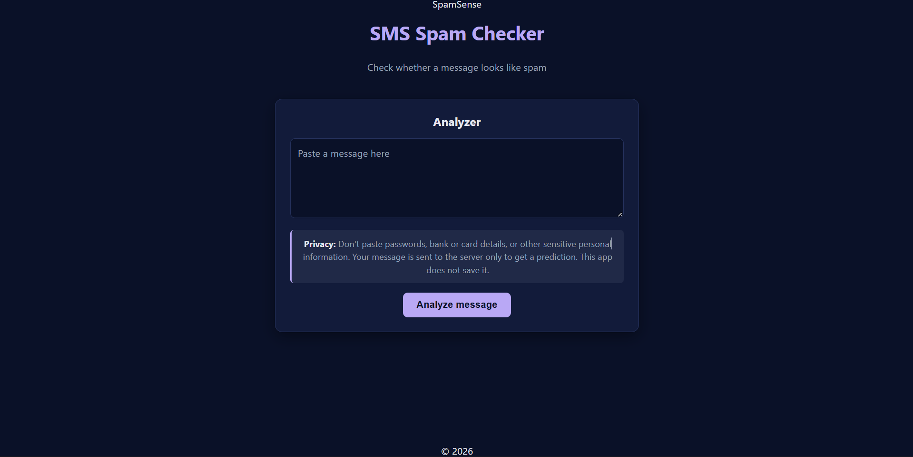
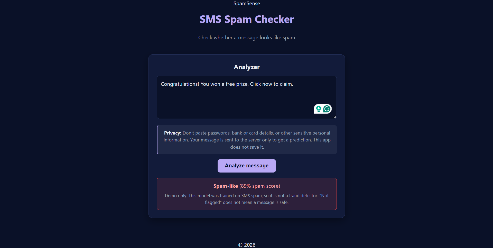
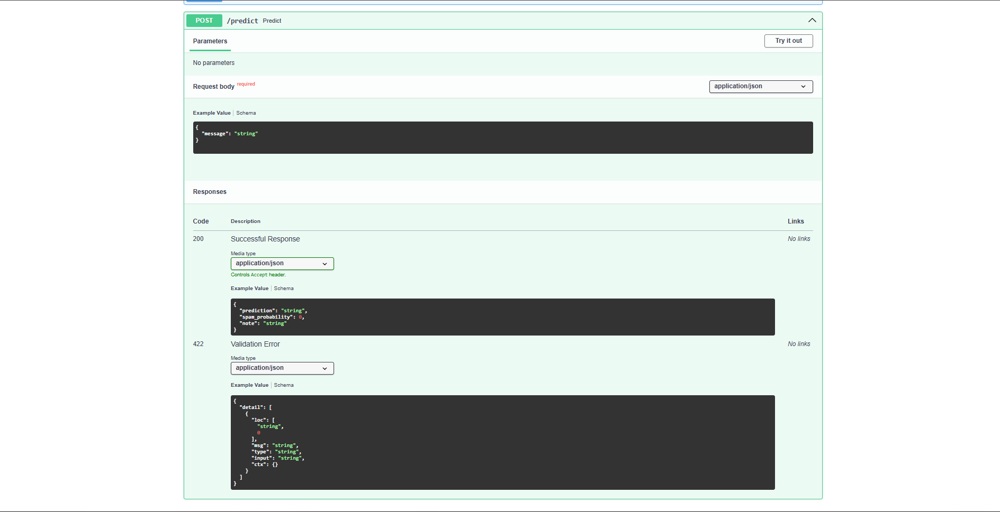

# SMS Spam Checker

Paste a text message and see whether it looks like spam. A beginner machine-learning project built end to end: React frontend, FastAPI backend and a scikit-learn model.

## Screenshots







## Important limitation

This model was trained on the SMS Spam Collection, which labels messages as **spam or ham (not spam)**. It does **not** detect verified fraud or scams. "Not flagged" does not mean a message is safe. This is a learning project and should not be used to make security decisions.

## Tech stack

- **Frontend:** React, Vite
- **Backend:** Python, FastAPI, Uvicorn
- **Model:** scikit-learn (TF-IDF + logistic regression), pandas, joblib
- **Testing:** pytest

## How it works

1. The user pastes a message in the React app.
2. The app sends it as JSON to `POST /predict`.
3. FastAPI runs the saved model and returns a label and a spam score.
4. The app shows the result.

## Model results

Trained on the SMS Spam Collection (UCI) with an 80% train / 20% test split.

| Metric (spam class) | Score |
|---|---|
| Precision | 0.98 |
| Recall | 0.67 |
| F1-score | 0.80 |

## Run it locally

You need Python 3.12+, Node.js (LTS) and Git.

**Backend**

```
cd Backend
python -m venv .venv
.venv\Scripts\Activate.ps1
python -m pip install -r requirements.txt
python -m uvicorn main:app --reload
```

The API docs open at http://127.0.0.1:8000/docs

**Frontend** (in a second terminal)

```
cd Frontend
npm install
npm run dev
```

Open http://localhost:5173

## Run the tests

```
cd Backend
python -m pytest
```

## Privacy

Don't paste passwords, bank details or other sensitive information. Messages are sent to the server only to get a prediction, and this app does not save them.

## Dataset

[SMS Spam Collection](https://archive.ics.uci.edu/dataset/228/sms+spam+collection) from the UCI Machine Learning Repository.